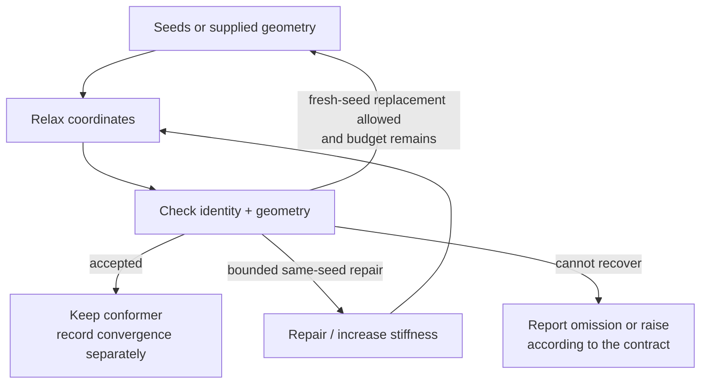

# Architecture

rxembed reads a chemical species, compiles its geometric requirements, builds coordinates with RDKit and checks
them. The species stays authoritative while coordinates are searched and relaxed.

## One call

`rx.embed("N->[Pd+2](<-[Cl-])(<-[Cl-])<-N")` runs:

1. Read the input: parse, add hydrogens and draw each metal bond as a dative (`api`, `identity/smiles_io`,
   `metal/centres`); an `.xyz` is perceived first (`perception/readers`).
2. Read the species: ligand stereo and each metal's polyhedron, donor seating and hand (`identity/reading`,
   `identity/species`, `stereo`). A Mol that is several species raises, naming `rx.isomers`, which enumerates them
   (`identity/arrangements`).
3. Compile one `Constraints` from the species and any `fix=`, `constrain=` or `contacts=` (`engine/seeding.prepare`,
   `metal/sphere`, `metal/distances`, `perception/contacts`, `geometry/constraints`).
4. Write it into RDKit's bounds matrix on the surrogate graph, where each metal is a bondless carbon
   (`geometry/bounds`, `geometry/mechanisms`).
5. Draw ETKDG seeds, keeping those with the requested hands and stereo (`engine/seeding`).
6. Relax each seed into its windows with restrained UFF (`geometry/relax`, `engine/conformers`).
7. Check the gates (`engine/acceptance.CORE_GATES`), replacing failures from fresh seeds.
8. Return an `Ensemble`, with real metals and notes restored (`ensemble`).

`rx.isomers` stops after step 2, `rx.minimize` skips step 5, and `rx.coembed` runs steps 3 to 7 on both endpoints of
a reaction (`engine/coembed`). Each species or contact mode is built on its own, and a collection keeps the failures
in `.errors`.

The surrogate graph and the other derived views (stripped ligands, stereo caps) feed the numerical models and never
become a second identity. Construction holds what the species specifies; reading a result describes its coordinates
and refuses a contradiction with the Mol. Results own their coordinates: construction and selection copy, a public Mol
is a copy, and changing coordinates drops what was derived from them. Force-field energies rank conformers within one
species; scoring and minimization share one restrained-UFF objective, and calculators get the chemical graph.

## Loops

An unconstrained `embed` returns ETKDG seeds as they are; the loop runs when relaxation is required or requested.

- Enumeration gives species, not conformers, after symmetry and feasibility screens.
- Preparation compiles twice, because the soft contacts it keeps change which donors are independent.
- Recovery never changes the `Constraints` or the gates; a required failure raises and a permitted one keeps its
  reason.
- Conformer search (`mc`) re-enters relaxation, acceptance and selection under the same species.

## Coembedding

Both endpoints share one mapped atom order and grow from one seed of a union graph whose changing bonds have zero
order, falling back to an endpoint's own seeds when no union seed passes. Each endpoint relaxes on its own chemical
graph, coupled atom by atom to its partner, and a pair is kept only when both pass their gates. `fixed=` holds one
supplied endpoint in its frame and builds the other there. rxts owns reaction mapping and TS scanning and takes a
`Coembedded`.

## Owners

| Responsibility | Owners |
|---|---|
| Input and composition | [`api`](src/rxembed/api.py), [`perception/readers`](src/rxembed/perception/readers.py), [`engine/atom_mapping`](src/rxembed/engine/atom_mapping.py) |
| Identity, stereo and enumeration | [`identity`](src/rxembed/identity/), [`stereo`](src/rxembed/stereo.py) |
| Requirements and preparation | [`geometry/constraints`](src/rxembed/geometry/constraints.py), [`metal`](src/rxembed/metal/), [`engine/seeding`](src/rxembed/engine/seeding.py) |
| Numerical construction | [`geometry`](src/rxembed/geometry/), [`engine/conformers`](src/rxembed/engine/conformers.py), [`engine/coembed`](src/rxembed/engine/coembed.py) |
| Acceptance | [`engine/acceptance`](src/rxembed/engine/acceptance.py) |
| Non-covalent contacts | xyzgraph detects them; [`perception/contacts`](src/rxembed/perception/contacts.py) proposes modes and holds them |
| Results and workflow | [`ensemble`](src/rxembed/ensemble.py), [`workflow`](src/rxembed/workflow/) |
| Binding patterns along a reaction path | rxflow |

The foundations `graph`, `stereo` and `utils` sit flat at the top. Each folder imports only them and the folders
before it: `geometry`, `metal`, `identity` and `engine` form the core (NumPy and RDKit), `perception` adds xyzgraph and
NetworkX, `workflow` the optional extras, and `api` and `ensemble` compose them.

## Open gaps

- A metal's sites have three views: the atoms that form one site (`graph.haptic_sites`), the identity record
  (`metal/centres.Site`) and the engine's centroid atoms (`Constraints.haptic`). The index map between them
  (`Sites`, `Collapsed`) numbers centroid dummies per centre in one form and per species in the other; no per-centre
  number leaves the call that made it.
