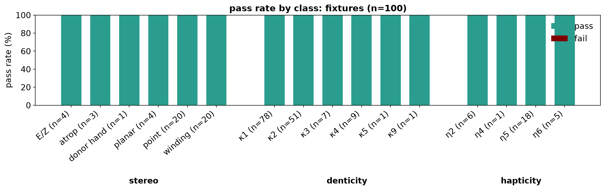
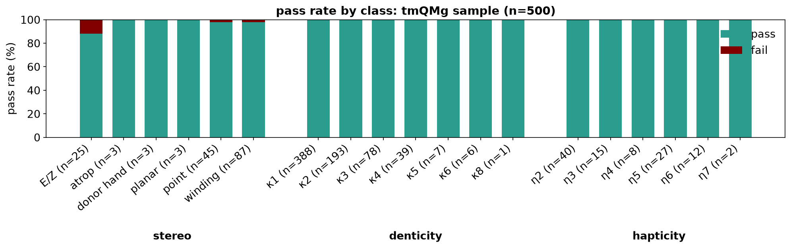

# rxembed: Constrained conformer embedding for reactive chemistry

rxembed generates 3D conformers around requested geometry: distances, angles, rigid transition-state cores,
coordination polyhedra and non-covalent contacts. It edits RDKit's distance bounds before embedding and holds
the constraints through a restrained UFF relaxation.

[](https://github.com/aligfellow/rxembed/LICENSE)
[](https://docs.astral.sh/uv)
[](https://github.com/astral-sh/ruff)
[](https://github.com/astral-sh/ty)
[](https://github.com/aligfellow/rxembed/actions)
[](https://codecov.io/gh/aligfellow/rxembed)

## Installation

rxembed is not yet on PyPI. Install it from a clone:

```bash
git clone https://github.com/aligfellow/rxembed.git
cd rxembed
pip install .                     # base: NumPy, RDKit, NetworkX and xyzgraph
pip install '.[workflow]'         # adds pruning, representatives and plots
pip install '.[search,workflow]'  # full: adds OpenConf Monte Carlo search
```

xTB scoring and optimization need the [xTB executable](https://github.com/grimme-lab/g-xtb) on `PATH`.
Set `os.environ["XTB_EXE"] = "/path/to/xtb"` in Python, or `$XTB_EXE` before starting, to use a specific one.

## Quick Start

```python
import rxembed as rx

ens = rx.embed("OCCCCO", n=20).minimize()
best = ens.lowest(3)
best.dump("best.xyz")  # three conformers in one multi-frame XYZ
```

`rx.isomers`, `rx.embed` and `rx.coembed` start from a species, given as a SMILES or an RDKit `Mol` (read an `.xyz`
with `rx.read_xyz`); every other verb reads a `Mol` you hold, whose atoms its indices name. `rx.embed` always makes
new coordinates; `rx.minimize` relaxes existing ones. One species returns an `Ensemble`; a sequence of species, such
as the stereoisomers or metal arrangements `rx.isomers` returns, gives an `EnsembleSet`, a list of ensembles whose
methods apply to every member, as does `contacts="auto"`, one member per binding mode. A source that is several
species raises and names `rx.isomers`. The examples below run from the root of a clone. The
[notebooks](examples/) go from [the bounds matrix](examples/00_how_it_works.ipynb) to
[reaction endpoints](examples/10_coembedding.ipynb).

## Constraints and Rigid Cores

Every input shares the same `fix`, `constrain` and `contacts` arguments. Atom indices are 0-based;
`rx.match(mol, smarts)` resolves a unique SMARTS match, in the drawn Lewis form or else any resonance form,
or raises.

| constraint | call |
|---|---|
| a numeric distance, angle or dihedral | `fix={(i, j): 2.05, (i, j, k): 170.0, (i, j, k, l): 180.0}` |
| a soft numeric window, or one value held within 0.1 Å or 5° of it | `constrain={(i, j): (2.0, 2.2), (i, j, k, l): 180.0}` |
| a rigid core | `fix=[i, j, k]`, `fix={i: (x, y, z)}`, or `fix=rx.Template(ref, SMARTS_or_map)` |
| a coordination polyhedron | `rx.isomers(smiles, geometry="octahedral")` |
| a requested NCI grip or π stack | `constrain={(ring_a, ring_b): 3.5}` |
| every proposed NCI binding mode, one result each | `contacts="auto"` |
| the binding modes of chosen contact kinds, one result each | `contacts=rx.contacts(mol, kinds=("HB", "CHPI"))` |
| one binding mode | `contacts=modes[label]` |
| the contacts an input geometry makes | `contacts="input"` |

A rigid core keeps its internal geometry. Its position and orientation may change to fit each newly embedded
conformer's frame.

```python
ref = rx.embed("OCCCCO", n=1)
held = rx.embed(ref.mol, fix=[0, 1, 2], n=4)  # atoms 0-2 keep ref's geometry exactly
grafted = rx.embed("OCCCCCO", fix=rx.Template(ref, {0: 0, 1: 1, 2: 2}), n=4)  # copied onto another molecule

core = "[F].[#6]-[Cl]"  # an SN2 transition state onto a new substrate
ts = rx.read_xyz("examples/structures/sn2.xyz", charge=-1)
reaction = rx.embed("[F-].c1ccccc1CCl", fix=rx.Template(ts, core), n=4)
fluoride, carbon, chloride = rx.match(reaction.mol, core)
reaction.measure((fluoride, carbon))  # forming bond
```

A symmetric SMARTS, or a reference with coordinates only, needs an explicit `{target_index: reference_index}`
map. Dot-separated molecules embed in one frame with each free fragment kept beside the others. See
[constraints](examples/03_constraints.ipynb), [NCI modes](examples/04_nci.ipynb) and
[transition states](examples/05_transition_states.ipynb).

### Non-covalent contacts

`rx.contacts` proposes binding modes between fragments, each a labelled tuple of contacts such as `HB:O3->N7`
(the acid O-H to the pyridine N below), and `contacts=` holds them while embedding. `contacts="auto"` embeds every
mode built from the default kinds: H-bonds (HB), halogen, chalcogen and pnictogen bonds (XB, ChB, PnB), ion pairs
(IONIC) and cation lone pairs (CATLP). `kinds=` chooses others.

```python
pair = "CC(=O)O.c1ccncc1"
every = rx.embed(pair, contacts="auto", n=4)  # an EnsembleSet, one Ensemble per default mode

mol = rx.parse_smiles(pair)  # contacts name atoms of a Mol you hold
found = rx.contacts(mol, kinds=("HB", "CHPI"))  # the modes built from these kinds only
chosen = rx.embed(mol, contacts=found, n=4)  # each of them, or pass a dict of some
one = rx.embed(mol, contacts=found["HB:O3->N7 + CHPI:C0->pi(4,5,6,7,8,9)"], n=4)  # one mode, an Ensemble
window = rx.embed(mol, constrain={(3, 7): (2.6, 2.9)}, n=4)  # only the O...N distance, your window
```

A contact holds its H and angle as well as its distance: the HB above holds H...N at 1.6 to 2.2 angstrom with
O-H...N near linear, and `constrain=` holds just the window given. Ring contacts (CHPI, HBPI, CATPI, ANPI, HALPI)
join a mode only when `kinds=` names them; pi stacking has no hold and is counted after embedding by
`ensemble.binding_modes()`. Each mode prefers the strongest kind on a site pair, HB over IONIC.
`rx.contacts(mol, observed=True)` lists the contacts a geometry makes without moving it, and `contacts="input"`
holds those of the default kinds; combine chosen ones as `contacts=(*found[a], *found[b])`. `modes=False` lists
single candidates, intramolecular and unholdable ones included. xyzgraph decides which atoms can make each contact;
a terminal metal hydride accepts an H-bond at its H, `D-H...H-M`. See [NCI modes](examples/04_nci.ipynb).

## Metal Complexes

```python
isomers = rx.isomers("CCCN->[Pd+2](<-[Cl-])(<-[Cl-])<-NCCC", geometry="SPL")
print(isomers.summary())
trans = isomers.select(label="trans")
trans_confs = rx.embed(trans, n=10)
all_confs = rx.embed(isomers, n=10)  # every isomer
```

`rx.isomers` takes a SMILES or a `Mol` and returns every distinct species as a `SpeciesSet`: for a metal each
arrangement, for an organic each stereoisomer. Each species is a `Mol` that `rx.embed` accepts.
Dative SMILES with charged anionic ligands, as above, is preferred and covalent SMILES is accepted. Write
hydrides, H₂ and bridging hydrogens explicitly. RDKit's `@SP`, `@TB` and `@OH` tags on a SMILES specify an
arrangement as the CX notes do: `rx.isomers("[Cl-]->[Pt@SP1+2](<-[Cl-])(<-[NH3])<-[NH3]")` is cis-platin alone.
`.select()` returns the one species matching `label`, `stereo` or `index`, or raises; `.filter()` returns a subset.
An `EnsembleSet` selects its members the same way, and by contact mode with `nci=`.
`rx.identity(mol)` names a species: two `Identity` records are equal when they name one species (its canonical CX
SMILES, atom maps and properties aside), and `labels` (cis/trans or mer/fac, up to six sites) and `arrangements`
name each metal centre, seated as the CX notes seat it, as every set's names do.

Several metals, from a SMILES as from a geometry, are enumerated together: each species their arrangements
combine into is listed once, and one that seats two atoms bridging the same pair of metals trans at either is
dropped, so the SMILES of [Pd2Cl6]2- is one species that `rx.embed` takes. `center=` enumerates one metal and
keeps the others as a geometry measures them, so it needs one. More than 1,000 combinations, or three or more
metals that bridging ligands join, refuse.

Geometries by coordination number, default first: 1 `MCO`; 2 `LIN`; 3 `TPL`, `TSH`, `TPY`; 4 `SPL`, `TET`, `SEE`;
5 `TBP`, `SPY`; 6 `OCT`, `TPR`, `HPL`; 7 `PBP`, `COC`, `CTP`; 8 `SQA`, `DOD`; 9 `TCT`; 10 `BSA`; 11 `ECI`. Codes
and full names (`octahedral`, `t_shape`) are case-insensitive, and an unknown name lists them all. Without a
geometry, rxembed classifies the input coordinates or takes the default. Each haptic face (a side-on bond, Cp,
an arene) is one site bound through its centroid; four sites with an η3 or larger face default to tetrahedral.
An alkali ion needs no geometry: `rx.embed("C1CC[O](C1)->[Li+](<-[O]1CCCC1)(<-[O]1CCCC1)<-[O]1CCCC1")` holds
each dative donor at ionic contact, in no fixed direction.

A `fix` or `rx.Template` that pins coordination-sphere atoms must seat them where the species specifies them, or
`rx.embed` refuses it. `rx.isomers(mol, fix=core)` takes the same `fix` and keeps only the species the core
agrees with, so `rx.embed` accepts each under it; `rx.isomers(mol, observed=True)` reads the one a whole reference
shows. `coordinate=` of `rx.isomers` binds a fragment's donor, as SMARTS or an atom index, to an open vertex,
giving one species per vertex the complex's symmetry does not exchange:

```python
mn = rx.read_xyz("examples/structures/mn-h2.xyz", charge=-1)
core = rx.Template(mn, {i: i for i in (1, 5, 63, 64, 65, 66)})  # Mn, N5, H63 and the H-H...O of a reacting core
held = rx.isomers(mn, geometry="OCT", center="Mn", fix=core)  # the 12 of 15 arrangements this core allows
mn_confs = rx.embed(held[0], fix=core, n=4)

templated = rx.embed(trans, fix=rx.Template(trans_confs[0], {0: 0, 1: 1, 2: 2}), n=10)
bound = rx.embed(rx.isomers("N->[Pt](Cl)Cl.CC(C)=O", geometry="SPL", coordinate="[OX1]").select(index=0), n=10)
```

### Stereo

`stereo=` on `rx.isomers` controls point R/S, E/Z, atropisomer M/P and bound-donor hands:

| `stereo=` | effect |
|---|---|
| omitted | a SMILES enumerates only its undefined stereo; a geometry keeps what it measures, except a diene's class |
| `"racemic"` | enumerate every configurable element, defined ones included |
| `"free"` | no enumeration; specified hands stay and the seed decides the rest |
| `{"N5": "racemic"}` | set the mode of one atom, named by element and index |
| `{"locked": "racemic"}` | enumerate both hands of every coordination-locked donor, such as a bound amine N |

A dict can also key a mode (`"preserve"`, `"racemic"`, `"invert"`, `"free"`) by kind: `"point"`, `"ez"`,
`"axial"`, `"locked"` or `"default"`. `rx.embed` applies a request that leaves one species to what it reads, a
geometry as a SMILES: `rx.embed(mol, stereo="invert")` embeds the mirror image of what `mol` specifies or shows,
every point, axial, haptic-face and metal hand inverted and every E/Z kept; `{"ez": "invert"}` flips E/Z. A bound
diene is s-cis or s-trans, each an isomer ([07_metal](examples/07_metal.ipynb)); s-trans binding is rare (10 of 358
open-chain η4 dienes in tmQMg), so compare the classes with a real energy, or keep the observed one with
`observed=True`. In a metal complex, a biaryl axis is undefined stereo when it is locked: by a chelate, its two
rings each carrying a donor of one metal next to the axis (BINAP, BIPHEP), or by a substituent or ring fusion on all
four ortho atoms (NAPHOS). `rx.isomers` then gives an M and a P species. Any other axis, and any organic one, is
stereo only when specified (CX `wU`/`wD`).

```python
locked_hands = rx.isomers(rx.read_xyz("examples/structures/mnh.xyz", charge=0), stereo={"locked": "racemic"})
```

### Shape check

An accepted conformer's sphere reads as the requested polyhedron within 0.01 of the best fit (0 is ideal); one
that slid into another shape is rejected. Each conformer's `check()` report gives the reading:

```python
cid = trans_confs.ids[0]
print(trans_confs.check()[cid].shape)  # e.g. Pd4 SPL 0.070 (next SEE 0.322)
```

`rx.ligands(mol)` splits a complex into ligands. See [metals](examples/07_metal.ipynb),
[catalysts](examples/08_metal_catalysts.ipynb) and [metal SMILES](examples/09_metal_smiles.ipynb).

## XYZ Input

```python
mol = rx.read_xyz("examples/structures/mnh.xyz", charge=0, bond_orders="xyz2mol")
atoms = [("O", (0.0, 0.0, 0.0)), ("H", (0.96, 0.0, 0.0)), ("H", (-0.24, 0.93, 0.0))]
water = rx.read_xyz(atoms, charge=0)  # in memory, no file; from ASE: list(zip(a.get_chemical_symbols(), a.positions))
```

By default xyzgraph perceives bonds and bond orders. xyz2mol bond orders optimize
transition-metal valence; keep xyzgraph's for reactive or multicentre bonds such as a TS or a bridging hydride. The
alternatives `connectivity="rdkit"` and `"xyz2mol"` need xyz2mol bond orders. An XYZ stores no charge, so by default
xyzgraph reads it (a metal-free molecule's best closed-shell total, 0 for a complex): pass the real charge for a radical
(`charge=0`), a charged complex or another connectivity, and `metal_charges={0: 2, 1: 1}` for a split the total does
not fix. `read_xyz` warns when a metal looks like an ion read as neutral, and on every perception change,
which never alters the atoms, their order or the charge; `fallback=False` raises instead, as does a failed xyzgraph
read without a charge.
`bond_orders=None` skips only the bond-order step (single bonds, dative metal bonds, no formal charges), for
checking which bonds a geometry has, a radical or zwitterion included.

```python
mol = rx.read_graph(graph, charge=0)  # graph: a Mol whose bonds are known, hydrogens as atoms
```

`rx.read_graph` gives the Lewis structure of a bonded graph, such as a reaction product assembled from its
reactants: bond orders, formal charges, dative metal bonds and the metal's oxidation state, without a conformer.
It ranks the bonds as `bond_orders="xyz2mol"` does and needs no extra; with no coordinates to break a tie, it
reads the Lewis structure with the fewest charges.

## Reaction Endpoints

`rx.coembed` generates paired reactant and product conformers in one frame, as start points for reaction-path or
transition-state searches. It aligns the unchanged atoms while the reaction centre moves; the product comes back on
the reactant's atom order, so atom i is one atom in both and frame k of the two endpoints is two frames of one
system. Each endpoint is built to its own graph and specified stereochemistry.

```python
reactant = "[CH3:1][CH2:2][CH2:3][NH2:4].[OH:5][H:99]"
product = "[CH3:1][CH2:2][CH2:3][NH2+:4]([H:99]).[OH-:5]"
pairs = rx.coembed(reactant, product, n=4, seed=42)
reactant_mol, product_mol = pairs[0].reactant.mol, pairs[0].product.mol
best = pairs.lowest(2)  # the two lowest-scoring pairs; pairs[a:b] picks by position
print(pairs.alignment_scores)  # spectator-atom RMSD, Angstrom
pairs.reactant.dump("reactant.xyz", align=False)
pairs.product.dump("product.xyz", align=False)  # matching frames form a pair
```

`pairs` is a `Coembedded` batch: `len(pairs)` counts pairs, and `pairs[0]` is a one-pair batch with named
`reactant` and `product` Ensembles. Indexing, slicing and `lowest` select both endpoints together. Their `.mol`
properties return coordinate copies. Scores rank the coupled objective; acceptance and optimizer convergence
remain distinct, and a score alone is not a final joint-gradient certificate.

Supply the endpoints as SMILES, CX SMILES or Mols, including an `.xyz` read with `rx.read_xyz`. Each endpoint must
specify one species, selected with `rx.isomers` when needed. Pass them as two arguments, a pair or one
`"reactant>>product"` SMILES. Stereo neither endpoint states is not enumerated: both endpoints take the hand the
shared seed gives, and a pair whose endpoints come out with different hands is rejected. To choose a hand, state it
in the SMILES or pick a species with `rx.isomers`. Both hold the same atoms; atom maps resolve ambiguous graph
overlays and distinguish atoms in a degenerate exchange. Identical endpoints are also supported. Atoms whose bonding
or specified stereo differs between the endpoints react; the rest are spectators. A change of a metal's specified
arrangement (cis to trans, mer to fac, its hand) reacts at the metal and the fewest donors that move. The product's own atom indices are not kept: map its atoms to read its
order back, since atom maps stay on both endpoints. `spectator_atoms=` and `react_atoms=` select the aligned and the
reacting atoms, and `constrain=` and `contacts=` hold both endpoints where they apply, all by reactant index.
`contacts="auto"` gives a `CoembeddedSet`, one `Coembedded` per binding mode (`.filter(nci=mode)` keeps one) and the
failed modes in `.errors`. For reaction-path sampling, request more than three pairs and inspect their approach
geometries; accepted endpoints can still have a poor reaction approach. Fewer pairs than asked may pass both
endpoints' checks. Keep the shared frame with `align=False` when writing and `auto_align=False` when drawing with
`xyzrender`. See [coembedding](examples/10_coembedding.ipynb).

To retain an existing conformer while constructing its partner, pass its Mol and choose the fixed side explicitly:

```python
reactant = rx.embed("CC(=O)C", n=1, seed=1).minimize().mol
pair = rx.coembed(reactant, "C=C(O)C", fixed="reactant")
```

Both routes use the same pair construction, coupled relaxation and validation. `fixed="reactant"` or
`fixed="product"` uses the supplied conformer as the shared starting geometry and preserves that endpoint's
coordinates in their supplied frame, constructing one partner (`n=1` or omitted). Select exactly one finite 3D
conformer. Added hydrogens are placed once and held; the caller's Mol is unchanged. Both endpoints must pass
their checks, and a failed construction raises rather than moving the fixed geometry. Supply another conformer
or omit `fixed` to generate both endpoints. This mode
does not draw random seeds; `source_seeds` holds None for the constructed pair. Without `fixed`, coordinate
inputs retain the shared-seed behavior described above.

rxts accepts this result directly as `guesser.paths(pair)`, retaining its paired geometries and count during
preparation. The later TS search can relax those coordinates.

Coembedding uses a shared union seed, bounded endpoint preparation and coupled relaxation. The defaults suit most
runs; to change them pass `coembed_params=rx.CoEmbedParams(...)`. `seed_relax_iters` caps preparation and
`joint_max_iters` each endpoint update, both 100 by default, and `seed_relax_iters=0` skips preparation; `max_cycles`
caps the coupled cycles at 100. They are separate limits, not one total step count.

## Save Results

```python
print(rx.smiles(mn_confs.mol))  # connectivity
print(rx.cxsmiles(trans))  # also the selected metal arrangement; rx.embed reads it back directly
mn_confs.dump("mn.xyz")  # one multi-frame XYZ
paths = all_confs.dump("palladium.xyz")  # one file per species
```

Neither SMILES stores `fix` or `constrain`. `ens.mol` is a normal RDKit `Mol`, so RDKit's writers work too.

## Workflow Operations

```python
searched = rx.embed("OCCCCO").mc(preset="rapid").minimize().prune()
representatives = searched.representatives()
optimized = searched.score("gxtb").lowest(3).optimize("gfn2")
walk = rx.embed(trans, n=1, trajectory=True)  # walk.trajectory holds the seed and UFF snapshots
walk.dump_trajectory("cleanup.xyz")
```

- `mc()` needs the `search` extra; `prune()`, `compare()` and `representatives()` need `workflow`.
- `ensemble.compare(reference, candidate, max_rmsd=0.25)` compares two selected conformer ids without moving
  or minimizing them. It returns None or a `Comparison` with `rmsd`, `maximum` (angstrom) and `order`, where
  `order[i]` is the candidate atom corresponding to reference atom `i`. Use `hydrogens=True` to fit all atoms.
- `minimize()` is restrained UFF, and `energy_kind` names the model behind each ensemble's energies. When UFF
  needs a stand-in the kind says `surrogate`. `score("ff")` uses that same objective, including constraints and
  interfragment terms, at the requested minimization stiffness, never a recovery rung. After the existing
  implicit `minimize()`, its single point preserves coordinates and convergence state. A wrapped final geometry
  uses the default stiffness. `best()` ranks species only by one given or calculator energy.
- Results own their coordinates; indexing copies them, and `.mol` returns a chemical copy. To change coordinates, edit `.mol` and pass it to `rx.minimize` with the intended
  `fix`/`constrain` request. Previous constraints, contacts and sampling are not replayed. `rx.wrap` carries or
  scores supplied geometry; its graph-only contract does not prepare metal coordination for minimization.
- `check()` reports geometry problems per conformer and `filter("geometry")` drops them. `optimize()` does not
  apply this report automatically.
- For unchanged connectivity, `optimize()` preserves the specified coordination shape, stereo and numeric fixes,
  allowing distortion beyond the embedding model's fit limit. Changed connectivity is flagged for
  `filter("connectivity")`.
- `rx.changes(mol, conf_id, reference=None)` reads whether a geometry is still its species: the bonds it forms and
  breaks and the stereo it contradicts, against what `mol` specifies or a `reference` geometry.
- `score()` also takes a caller-supplied ASE calculator, such as `rx.ASE(XTB())` from
  [xtb_ase](https://github.com/Quantum-Accelerators/xtb_ase). See [conformers](examples/02_conformers.ipynb).

## Embedding Settings

`n`, `seed` and `threads` go to `rx.embed`; everything else about seeding is one `rx.EmbedParams`. The default
model is RDKit's `KDG()` with bounded all-in-one refinement, then legacy random starts for missing seeds.
Pass another model as `native` to keep its own search settings:

```python
from rdkit.Chem import rdDistGeom

params = rx.EmbedParams(native=rdDistGeom.srETKDGv3())
ens = rx.embed("C1CCCCC1O", n=3, seed=42, params=params)
again = rx.embed("C1CCCCC1O", n=3, seed=42, params=params)  # the same conformers
```

Set `prune_rms` on `EmbedParams`, not on the native object, and geometry through `fix` and `constrain`. The
switches `coplanar_14`, `metal_floor_relief`, `donor_orientation` and `conjugation` each remove one of rxembed's
additions, for study ([07_metal](examples/07_metal.ipynb)). `max_iters=` on `rx.embed` and `rx.minimize`
caps their UFF relaxation; coembedding's preparation and coupled limits are described above.

## Errors and How It Works

Distance geometry seeds each conformer from RDKit's bounds matrix with the requested geometry written in
([00_how_it_works](examples/00_how_it_works.ipynb)). Restrained UFF cleans each seed, and a gate checks bonds,
clashes, the polyhedron, hands, stereocentres and `fix` values, retrying with stiffer restraints and then fresh
seeds. The metal is a stand-in atom during both; every check that reads the graph (stereo, connectivity,
geometry QA) reads it with the real metal and its charge restored.

A single request that cannot be built raises `EmbeddingError`: one sentence naming the species, the most common
reason and a remedy, with every rejected seed counted in `err.failures`. A request that expands into several
candidates returns what embedded, lists the rest in `result.errors`, and raises only when none embeds. A
warning means the result differs from the request. `rx.set_verbose("DEBUG")` shows every retry.

## Metal performance

Each structure is read from its XYZ, written as a CX SMILES, and embedded fresh from that CX string; it
passes when the embedded CX matches. `just bench` runs the 100 shipped fixtures, `just bench tmqmg
--size N` a diverse tmQMg sample.




[benchmark/README.md](benchmark/README.md) has timings, per-metal breakdowns, core RMSD and the sample's
coverage of tmQMg.

## Development

```bash
just setup  # uv sync and pre-commit
just check  # format, lint, types and tests; just test runs the tests alone
```

`uv sync` is the full development install and `uv sync --no-default-groups` the base tier. The metal round-trip
benchmark, with its [tmQMg](https://github.com/hkneiding/tmQMg) sample, is in
[benchmark/README.md](benchmark/README.md); [ARCHITECTURE.md](ARCHITECTURE.md) gives the package structure and
[AGENTS.md](AGENTS.md) the development rules.

## License

[MIT](LICENSE). Vendored components retain their upstream notices in [LICENSES.md](LICENSES.md).

## References

- [RDKit](https://github.com/rdkit/rdkit): embedding, ETKDG, UFF
- [openconf](https://github.com/rowansci/openconf): Monte Carlo conformational sampling
- [xyzgraph](https://github.com/aligfellow/xyzgraph): `.xyz` metal and TS perception
- [xyz2mol_tm](https://github.com/jensengroup/xyz2mol_tm): vendored, the alternative bond-order perceiver
- [xtb](https://github.com/grimme-lab/g-xtb): GFN-FF, GFN2-xTB and g-xTB
- [tmQMg](https://github.com/hkneiding/tmQMg): tmQMg dataset

Related projects:

- [MetalloGen](https://github.com/kyunghoonlee777/MetalloGen): automated transition metal complex conformer generation
- [Molassembler](https://github.com/qcscine/molassembler): molecular graphs, coordination stereochemistry and conformer generation
- [racerTS](https://github.com/digital-chemistry-laboratory/racerts): efficient conformer sampling for transition states
- [OIN-SMILES](https://github.com/tjmustard/OIN-SMILES): lossless conversion between 3D XYZ structures and 1D SMILES
